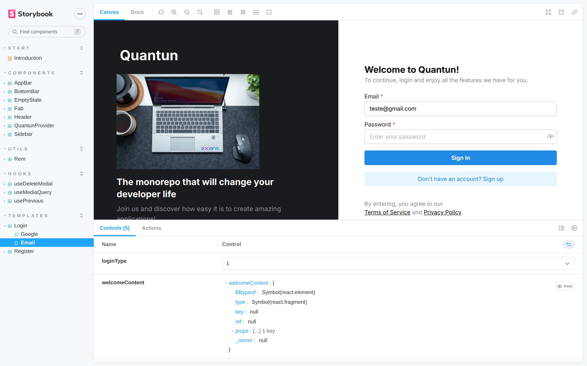
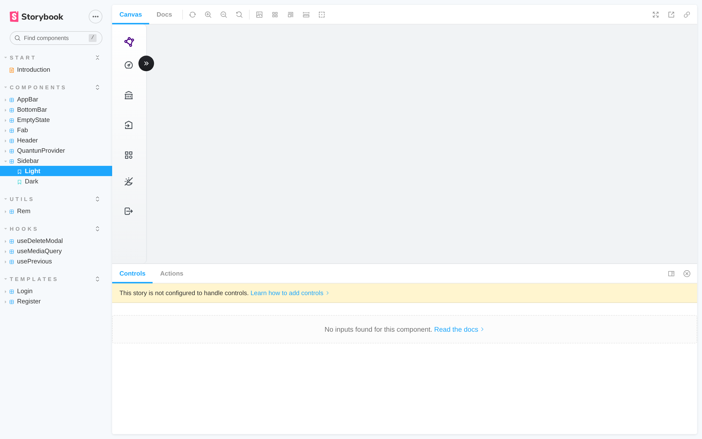
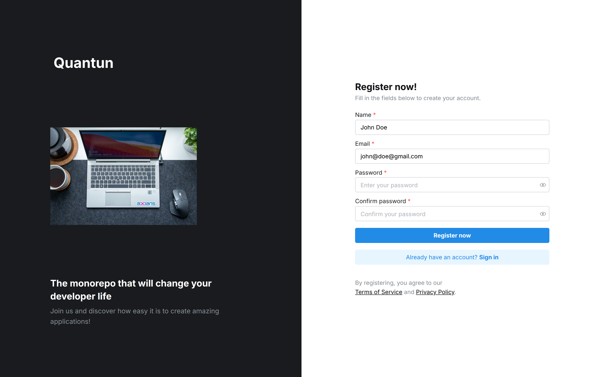
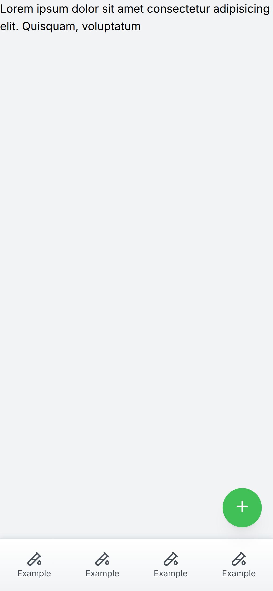
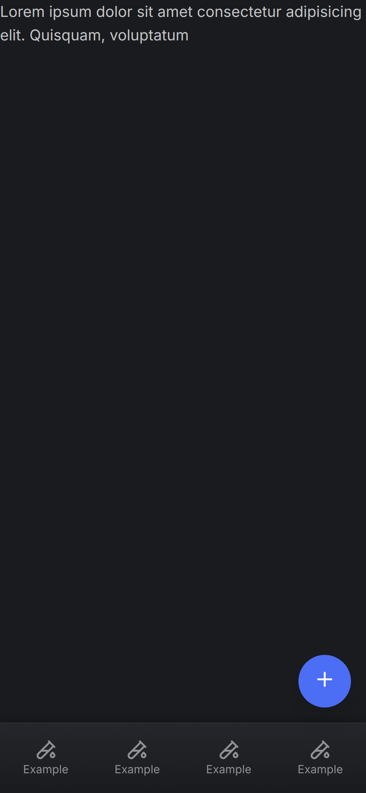

<div align="center">

# Quantun

**A Turborepo monorepo of React components, hooks, auth screen templates and shared tooling, built on Mantine and documented with Storybook.**


[**Live Storybook**](https://raniellimontagna.github.io/quantun/) •
[Packages](#packages) •
[Screenshots](#screenshots) •
[Monorepo layout](#monorepo-layout) •
[Running locally](#running-locally) •
[History](#project-history)

</div>

> [!WARNING]
> **Discontinued.** Quantun is no longer maintained and this repository is archived as a portfolio reference. The `@quantun/*` packages and `eslint-config-quantun` were removed from npm in 2026, so they can no longer be installed from the registry. The [Storybook](https://raniellimontagna.github.io/quantun/) is still online.



## About

Quantun was the shared foundation for my React side projects between 2022 and 2024. Instead of rebuilding the same layout pieces, auth screens and lint setup in every app, I kept them here as small packages, versioned them with Changesets and published them to npm from GitHub Actions.

Its main consumer was [Coin Keeper](https://github.com/RanielliMontagna/coin-keeper), a personal finance app whose provider, sidebar, mobile app bar and bottom bar, page headers, empty states, delete confirmation modal and sign-in/sign-up screens all come from Quantun.

## Packages

| Package | Last version | What it provides |
| --- | --- | --- |
| `@quantun/core` | 1.6.1 | `QuantunProvider` (Mantine theme, modals and notifications in one provider), `Sidebar`, `AppBar`, `BottomBar`, `Fab`, `Header`, `EmptyState` |
| `@quantun/hooks` | 1.2.0 | `useDeleteModal` (confirmation modal), `useMediaQuery`, `usePrevious` |
| `@quantun/utils` | 1.1.0 | `rem` unit helper |
| `@quantun/login-screen` | 2.1.1 | Sign-in screen template with email/password or Google variants and Zod validation |
| `@quantun/register-screen` | 2.1.0 | Sign-up screen template with password confirmation |
| `@quantun/tsconfig` | 1.1.0 | Shared `tsconfig` bases (base, Node 16, React library) |
| `@quantun/prettier` | 1.1.0 | Shared Prettier config |
| `eslint-config-quantun` | 1.0.0 | Shared ESLint config |

Components are written in TypeScript on top of Mantine 6 and Tabler Icons, which are peer dependencies, and bundled with tsup as ESM and CommonJS with type declarations.

## Screenshots

<table>
  <tr>
    <td width="50%"><p align="center"><sub>Every component, hook and template in Storybook</sub></p></td>
    <td width="50%"><p align="center"><sub><code>@quantun/register-screen</code></sub></p></td>
  </tr>
</table>

<p align="center">
  
  &nbsp;&nbsp;
  
  <br />
  <sub><code>Fab</code> and <code>BottomBar</code> in light and dark themes</sub>
</p>

### In production: Coin Keeper

<table>
  <tr>
    <td width="62%"><p align="center"><sub><code>LoginScreen</code> in Coin Keeper</sub></p></td>
    <td width="38%"><p align="center"><sub><code>Header</code> and <code>BottomBar</code> on mobile</sub></p></td>
  </tr>
</table>

## Monorepo layout

```text
apps/
└── docs/                    # Storybook 6.5 (Vite builder) with stories for every package
packages/
├── quantun-core/            # layout components and the provider
├── quantun-hooks/
├── quantun-utils/
├── quantun-tsconfig/
├── quantun-prettier/
└── eslint-config-quantun/
templates/
├── quantun-login-screen/
└── quantun-register-screen/
.changeset/                  # Changesets config for versioning
.github/workflows/release.yml  # published to npm on every push to master (now disabled)
```

## Tech stack

| Area | Tools |
| --- | --- |
| Components | React 18, TypeScript, Mantine 6, Emotion, Tabler Icons, Zod |
| Monorepo | Turborepo, pnpm workspaces |
| Build and release | tsup, Changesets, GitHub Actions |
| Docs | Storybook 6.5 with the Vite builder, hosted on GitHub Pages |
| Quality | Vitest, Testing Library, ESLint, Prettier, Husky |

## Running locally

Last checked in October 2026 on Node.js 24 with pnpm 8.

```bash
git clone https://github.com/RanielliMontagna/quantun.git
cd quantun
npx pnpm@8 install --frozen-lockfile

# Build the packages the Storybook imports
for d in packages/quantun-core packages/quantun-hooks packages/quantun-utils \
         templates/quantun-login-screen templates/quantun-register-screen; do
  (cd "$d" && npx pnpm@8 run build)
done

# Storybook
cd apps/docs
npx pnpm@8 run dev      # http://localhost:6006
npx pnpm@8 run build    # static site in storybook-static/
```

Storybook 6.5 still uses webpack 4 for its manager UI, so the scripts set `NODE_OPTIONS=--openssl-legacy-provider` and a 4 GB heap. In October 2026 the docs app moved from `@storybook/builder-vite` 0.1 and Vite 2 to builder-vite 0.2 and Vite 3, because the old builder no longer loaded stories.

To use a package in another project now that npm no longer has them, run `pnpm pack` in its folder and install the tarball with a `file:` dependency. The [Coin Keeper README](https://github.com/RanielliMontagna/coin-keeper#running-locally) has a full example.

## Project history

- **September 2022**: Turborepo setup, test environment and the npm release workflow.
- **December 2022**: shared ESLint config.
- **April 2023**: packages reach 1.0.0; provider, sidebar, mobile app bar and the login template.
- **June–July 2023**: email login, register template, header, empty state, new composable sidebar, bottom bar and hooks.
- **August 2023**: test setup reorganised.
- **February–March 2024**: last releases (login message, FAB colour per button).
- **2026**: packages removed from npm.
- **October 2026**: Storybook fixed and published to GitHub Pages; repository archived.

## License

[MIT](LICENSE) © Ranielli Montagna
